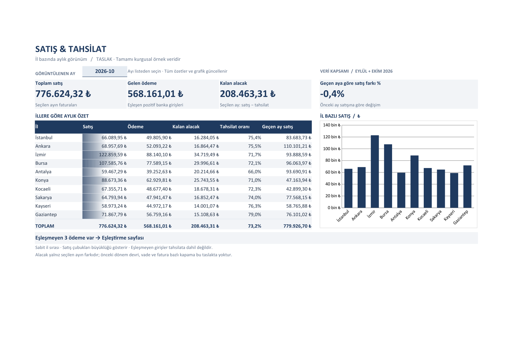

# Sales and collection dashboard

A Turkish Excel template for monthly sales and bank collections across ten provinces, with entirely fictional sample data.

Open [sales-collection-dashboard.xlsx](sales-collection-dashboard.xlsx) to explore the template. It starts on **Panel**, showing October 2026. Save a separate copy before replacing the sample inputs.



*Actual LibreOffice Calc PDF export rendered to PNG, without redrawing the sheet or replacing formulas with static values. This is a print preview, not a Microsoft Excel application screenshot.*

## Features

- A month selector, four summary cards, a ten-province table, sales data bars and a native column chart.
- Six Turkish worksheets: **Panel**, **Banka Dökümü**, **Satışlar**, **Müşteriler**, **Eşleştirme**, **Nasıl kullanılır**.
- Case-insensitive customer alias matching in bank descriptions. Only a single, unambiguous customer match with a province counts as a collection.
- A linked review list for unmatched positive payments. Zero and negative transactions are classified as non-sales.
- Formulas prepared for 2,000 sales rows, 2,000 bank rows and 100 customers; drop-down lists and frozen headers.
- 25 fictional customers, 140 sales and 110 bank transactions for September and October 2026. No macros or dynamic-array functions.

## Use the workbook

1. In **Müşteriler**, enter customer names, distinct bank-description aliases and provinces in A:C.
2. In **Satışlar**, replace inputs in A:E with dates, invoice identifiers, customers, provinces and amounts.
3. In **Banka Dökümü**, replace inputs in A:D with dates, descriptions, signed amounts and balances. Incoming amounts must be positive; outgoing amounts negative.
4. Select a month in **Panel!B4**. The summaries, chart and unmatched-payment list follow that selection.
5. Follow the dashboard warning to **Eşleştirme** and resolve customer aliases or province information.

Preserve the gray formula columns. Clear leftover sample input rows when replacing data, avoid duplicate imports, and keep dates and amounts as typed spreadsheet values. **Nasıl kullanılır** contains the Turkish instructions.

## Reproduce and verify

Use Python **3.11**. Dependencies, including transitive packages, are pinned in [requirements.txt](requirements.txt).

```bash
python -m venv .venv
# Linux/macOS
source .venv/bin/activate
# Windows PowerShell instead: .venv\Scripts\Activate.ps1
python -m pip install -r requirements.txt
python generate.py
python verify.py
```

`generate.py` overwrites the workbook with deterministic fictional inputs. `verify.py` expects this sample dataset and writes [docs/verification.txt](docs/verification.txt). It exits with a nonzero status on a failed check. It is a regression check for the template, not a validator for arbitrary business records.

### How it is verified

The verifier reads raw customer, sales and bank cells and independently computes totals in Python using integer cents. Separately, **formulas 1.3.4** evaluates the actual workbook formulas for September and October.

There are **61 panel comparisons per month, 122 in total**: five values for each of ten provinces, seven totals, the collection ratio, the monthly change, the unmatched count and the warning text. Money must match to the cent; ratios use a `1e-12` tolerance. Additional checks cover matched and non-sales transactions, the review list, empty capacity, formula errors, workbook structure and evaluation markers.

Boundary scenarios exercise the 2,000th sales and bank rows, the 100th customer slot, ambiguous aliases, resolving an unmatched payment and an empty month. These test inputs are not saved in the delivered workbook. After success, the verifier caches the evaluated October results for opening previews and checks that **all 22,065 formulas remain intact** and have their expected cached results. Opening or editing the workbook requests automatic recalculation.

The [GitHub Actions workflow](.github/workflows/verify.yml) installs the pinned dependencies on Ubuntu with Python 3.11 and runs `python generate.py && python verify.py` on push, pull request or manual dispatch. No hosted Actions run is claimed before the repository is published.

### LibreOffice cross-check

LibreOffice Portable **26.2.4.2** recalculated temporary copies after all formula caches were removed. Both months passed the same **122 panel comparisons**, plus transaction-status and review-list checks, with no spreadsheet error cells. Results also agree with the source template's control report. The delivered XLSX was not resaved by LibreOffice.

| Month | Sales (TRY) | Collections (TRY) | Within-month difference (TRY) |
| --- | ---: | ---: | ---: |
| September 2026 | 779,926.70 | 573,919.16 | 206,007.54 |
| October 2026 | 776,624.32 | 568,161.01 | 208,463.31 |

See [the LibreOffice check log](docs/libreoffice-verification.txt), [September print preview](docs/panel-2026-09.png) and [October print preview](docs/panel-2026-10.png). The portable application and temporary rendering files are excluded from the repository.

## Definitions and limits

- **Sales** are invoices dated in the selected month, grouped by the sale's province. **Collections** are that month's positive bank inputs matched to exactly one customer, grouped by the customer's province. Bank balances do not contribute to dashboard totals.
- **Kalan alacak** is only selected-month sales minus selected-month collections. There is **no opening balance, carry-forward receivable, invoice allocation, aging or due-date tracking**. The difference may be negative and collection ratios may exceed 100%.
- An unmatched positive payment is excluded from collections. Any positive transfer matching one customer is included, even if its economic purpose is not a sale; review descriptions before relying on totals.
- Alias matching uses `SEARCH`; it does not correct spelling, Turkish/Latin letter differences or abbreviations. Aliases must be nonempty, unique and distinctive, and must not contain `*`, `?` or `~`. Alternative aliases per customer are not modeled.
- The **ten provinces and their order are fixed**. Changing them requires updating the configuration lists, dashboard rows, named ranges and chart together. Rows beyond the prepared capacity are not automatically included. Update **Müşteriler!H2:H13** to change the month/year list.
- A zero previous-month sale produces a blank monthly change; a month with no sales has a zero collection ratio. The review list follows the selected month.
- Currency and date separators depend on the spreadsheet application's locale. Font substitution, display scaling and application differences can affect layout.
- **Microsoft Excel desktop and Mac interaction testing has not been performed.** Independent calculation and LibreOffice checks do not establish compatibility with every Excel version, bank export or business process.

## Türkçe özet

Türk küçük işletmeleri için 10 ilde aylık satış ve tahsilatı gösteren, tamamı kurgusal verili Excel şablonudur. Ay seçimi, müşteri adıyla ödeme eşleştirme, eşleşmeyen ödeme listesi ve grafik içerir. Kalan alacak yalnız ay içi farktır; önceki dönem devri ve fatura/vade takibi yoktur. Python ile 122 panel karşılaştırması ve ek sınır kontrolleri, LibreOffice ile önbelleksiz yeniden hesaplama yapılmıştır. Excel masaüstü/Mac üzerinde elle test edilmemiştir. Ayrıntılı kullanım adımları dosyanın **Nasıl kullanılır** sayfasındadır.

## License

[MIT](LICENSE).
